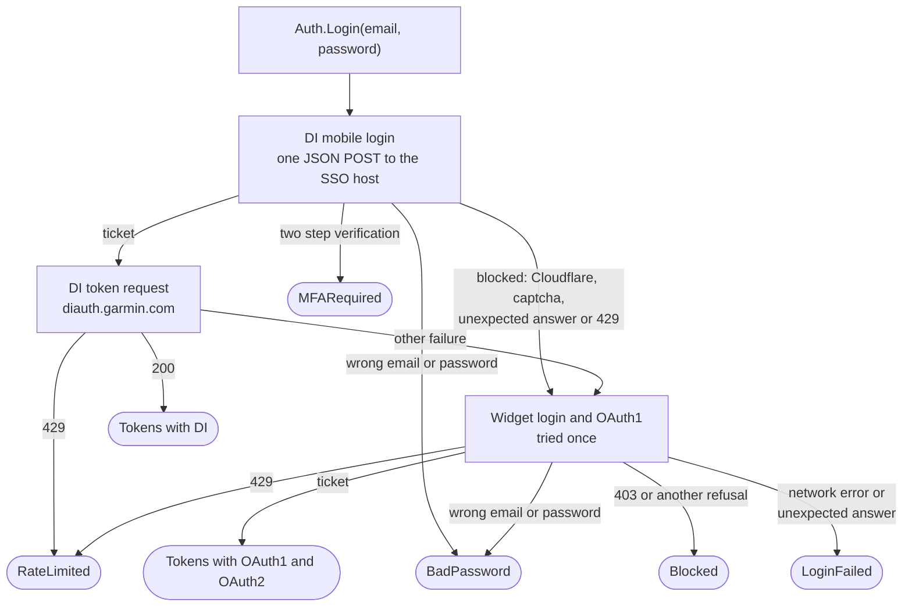

<div align="center">

# gconnect

**Sign in to Garmin Connect from Go, keep the login fresh, and fetch your health data as raw JSON.**

[](https://pkg.go.dev/github.com/danihrndzld/gconnect)
[](https://github.com/danihrndzld/gconnect/actions/workflows/ci.yml)
[](https://goreportcard.com/report/github.com/danihrndzld/gconnect)
[](https://github.com/danihrndzld/gconnect/tags)
[](LICENSE)
[](go.mod)
[](go.mod)

</div>

> [!WARNING]
> gconnect is an unofficial Go client for the private Garmin Connect API. It is not affiliated with, endorsed by, or supported by Garmin Ltd. Garmin and Garmin Connect are trademarks of Garmin Ltd. or its subsidiaries. The sign in flows were last checked against the live service on 2026-10-14. Garmin can change or block this private API at any time, and this library may stop working without notice.

## Why gconnect

- **Standard library only.** `go.mod` has no `require` line, and an architecture test fails the build if one appears.
- **It never touches the disk or the environment.** The library imports none of `os`, `path/filepath`, `io/fs` or `syscall`, so you decide where the tokens live.
- **Raw JSON.** All 42 endpoints return the bytes exactly as Garmin sent them, with Garmin's key order and number text intact.
- **A fake Garmin server for your tests.** `gconnecttest` serves both sign in flows, the token refresh and the data API on a loopback port.
- **Rate limit aware.** The client waits 500 ms between requests, honors `Retry-After` up to 60 s, and stops a run after 5 refused requests in a row.
- **Well tested.** 265 test cases, 236 of them labeled with a test design technique, reach 99.3 % statement coverage. CI fails under 95 %.

## Contents

- [Install](#install)
- [Quick start](#quick-start)
- [Sign in](#sign-in)
- [Tokens and refresh](#tokens-and-refresh)
- [Personal API key](#personal-api-key)
- [Rate limits](#rate-limits)
- [Results and stop reasons](#results-and-stop-reasons)
- [Endpoints](#endpoints)
- [Testing your code with gconnecttest](#testing-your-code-with-gconnecttest)
- [Security](#security)
- [Legal and ethics](#legal-and-ethics)
- [Versioning](#versioning)
- [Contributing](#contributing)
- [Credits](#credits)
- [License](#license)

## Install

```sh
go get github.com/danihrndzld/gconnect
```

gconnect needs Go 1.24 or newer.

| Feature | State |
| --- | --- |
| Sign in with the mobile (DI) flow | Supported. This is the flow the Android and iOS apps use. |
| Older web sign in (widget and OAuth1) | Supported. It is tried once, only when the mobile flow is blocked. |
| Token refresh | Supported for both kinds of login. |
| Two step verification (MFA) | Not supported. `Login` returns the code `MFARequired`. |
| Endpoints | 42 named endpoints: daily metrics, date ranges, activity splits, activity lists, goals, the profile, and 4 Personal API ranges. |
| Personal API | `Auth.ExchangeAPIKey` trades a key from Garmin's Personal API page for a 24 hour access token; `Client` then reads from `personal.connectapi.garmin.com`. |

## Quick start

This program signs in once, saves the tokens to a file you choose, and prints yesterday's daily summary. On later runs, load the saved tokens instead of calling `Login` again.

```go
package main

import (
	"context"
	"encoding/json"
	"fmt"
	"log"
	"os"
	"time"

	"github.com/danihrndzld/gconnect"
)

func main() {
	ctx := context.Background()
	auth := &gconnect.Auth{} // the zero value talks to the real Garmin

	tokens, err := auth.Login(ctx, os.Getenv("GARMIN_EMAIL"), os.Getenv("GARMIN_PASSWORD"))
	if err != nil {
		log.Fatal(err) // a *gconnect.LoginError; see "Sign in" below
	}
	save := func(t *gconnect.Tokens) error {
		b, err := json.Marshal(t)
		if err != nil {
			return err
		}
		return os.WriteFile("garmin-tokens.json", b, 0o600)
	}
	if err := save(tokens); err != nil {
		log.Fatal(err)
	}

	client := &gconnect.Client{Auth: auth, Tokens: tokens, OnTokens: save}
	name, err := client.Profile(ctx)
	if err != nil {
		log.Fatal(err)
	}
	stats, _ := gconnect.Lookup("stats")
	day := time.Now().AddDate(0, 0, -1).Format("2006-01-02")
	res := client.Get(ctx, stats, gconnect.Params{Date: day, DisplayName: name})
	if res.Code != "" {
		log.Fatal(res.Err)
	}
	fmt.Println(string(res.Data))
}
```

Store the tokens file with mode 0600. It holds the access and refresh tokens, which give full access to the account until they expire.

## Sign in

`Auth.Login` tries the mobile flow first: one JSON request to the SSO host, then a token request to `diauth.garmin.com`. If Garmin blocks that flow (a Cloudflare page, a captcha, an unexpected answer, or a 429 on the mobile login only), `Login` tries the older web widget flow once. It never retries after a wrong password, after an MFA prompt, or after a 429 from the token host.



Every failure is a `*gconnect.LoginError`. Its `Msg` never contains the password. The codes are:

| Code | Meaning | What to do |
| --- | --- | --- |
| `BadPassword` | Garmin rejected the email or the password. | Ask the user again. |
| `MFARequired` | The account uses two step verification. | This library cannot sign in to it. |
| `RateLimited` | Garmin answered 429. | Wait 15 minutes before any new sign in. |
| `Blocked` | Both flows were refused, usually with a 403. | Try later or from another network. |
| `LoginFailed` | A network error, an answer that is not JSON, or another unexpected answer. | Look at `Msg`. |

## Tokens and refresh

`Tokens` holds one login: `DI` for the mobile flow, `OAuth1`, `OAuth2` and `Consumer` for the older flow, or `Personal` for a Personal API key. The JSON field names match the ones Garmin and the garth project use, so you can marshal the struct as it is.

`Auth.Fresh` refreshes the tokens when the access token expires within a margin you choose, and tells you whether it did. `Client` calls it before every request with a 15 minute margin, and calls `Refresh` once more after a 401. Each time it gets new tokens it calls `Client.OnTokens`, which is where you save them. If `OnTokens` returns an error, the client logs a warning with the code `SAVE_FAILED` and keeps going with the new tokens in memory.

`Refresh` returns `ErrSessionDead` only when Garmin proves the login is dead: a 400 or 401 from the DI refresh, a 401 from the older flow's token exchange, or a DI login with no refresh token. A network error, a 5xx, a 403 or a 429 never invalidates a saved login. `Refresh` returns a plain error in those cases, and you should keep the old tokens and try again later. `Fresh` and `Refresh` return `ErrNoTokens` when the tokens hold no complete login.

## Personal API key

Since October 2026 Garmin offers an official, read only Personal API. A user creates a key at <https://connect.garmin.com/app/settings/personalApiToken> (it lives 30, 90, 180 or 365 days and Garmin shows it once). No password, MFA or SSO rate limit is involved.

```go
a := &gconnect.Auth{}
tok, err := a.ExchangeAPIKey(ctx, key) // one POST; save tok as you save any login
c := &gconnect.Client{Auth: a, Tokens: tok, OnTokens: save}
ep, _ := gconnect.Lookup("personal_daily_summaries")
r := c.Get(ctx, ep, gconnect.Params{Start: "2026-10-01", End: "2026-10-20"})
```

`Tokens.Personal` holds the key and the current access token, and `Kind` answers `KindPersonal`. Each access token lives 24 hours and has no refresh token, so `Refresh` buys the next one with the key. A 400 or 401 on that request means Garmin refused the key (wrong, expired or deleted) and returns `ErrSessionDead`; a 429, a 5xx or a network error is a plain error.

The Personal API host answers only its documented paths and 404 to the rest. On 2026-10-24 it answered these names from the table: `hrv`, `body_battery`, `daily_steps`, `agg_weigh_ins` and `activities_by_date`, plus the four `PersonalRanges()` endpoints below. Training readiness, training status, VO2 max, endurance and hill scores, race predictions, activity splits, goals, blood pressure and the social profile answered 404, so a caller that needs them still needs a sign in.

| Name | Range limit | Answer |
| --- | --- | --- |
| `personal_daily_summaries` | 90 days | `{"data": [...]}`: steps, floors, calories, heart rate, stress, intensity minutes, Body Battery, respiration and pulse ox per day |
| `personal_sleep` | 31 days | `[...]` of `dailySleepDTO` shaped rows |
| `personal_hrv` | 90 days | `{"hrvSummaries": [...]}` of `hrvSummary` shaped rows |
| `personal_body_battery` | 31 days | `[...]` of the rows `body_battery` answers for one day |

## Rate limits

Garmin limits sign ins per account. On 2026-10-14, after 4 sign ins within 40 minutes, the next one got a 429, and the account could not sign in for a while, in the official app too. Sign in once and keep the tokens. Never call `Login` in a loop or retry it automatically. After `RateLimited`, wait at least 15 minutes. The library does not keep a cooldown for you, because that needs storage. Keep one in your program if users can press a sign in button repeatedly.

For data requests, `Client` follows these rules:

| Event | What the client does |
| --- | --- |
| Any request | It waits at least `Gap` since the last one. The default is 500 ms. A negative `Gap` turns the pause off, which is only sensible against a local fake server. |
| 429 | It waits for `Retry-After` (seconds or an HTTP date, at most 60 s) or for the backoff, at most 2 times. A third 429 stops the run with `StopRateLimited`. |
| Network error or timeout | It retries up to 5 times. Each attempt has a 30 s timeout by default. The wait is `min(5000 * 2^attempt + jitter, 60000)` ms, with a jitter of 0 to 999 ms. |
| 403 | It skips that request and keeps the tokens. A 403 on the profile, or 5 in a row, stops the run with `StopBlocked`. |
| 401 | It refreshes once and retries. A second 401 stops the run with `StopSessionDead`. |
| 204 or an empty body | It counts as a success with no data. |
| An answer over 1 MB | It reads at most 1 MB and returns the code `TOO_LARGE`. |

## Results and stop reasons

`Get` returns a `Result`. `Data` holds the raw JSON bytes exactly as Garmin sent them, so you can decode them into your own types or store them unchanged. `Code` is empty on success. Otherwise it is one of `BAD_JSON`, `TOO_LARGE`, `TIMEOUT`, `NETWORK`, `AUTH`, `FORBIDDEN`, `RATE_LIMIT`, `HTTP_4XX` or `HTTP_5XX`, and `Err` describes the failure with any secrets removed. `Safe` is a shorter form for callers that skip what fails: it returns the data or nil, and logs the reason through `Client.Log`.

Once a run has stopped, `Client.Stopped` returns a `*StopError`, and every later `Get` returns at once without sending anything. Its `Reason` is one of these:

| Reason | Cause | What to do with the saved tokens |
| --- | --- | --- |
| `StopSessionDead` | Garmin proved the login dead. | Delete them and sign in again. |
| `StopRateLimited` | A third 429 for the same request. | Keep them and try later. |
| `StopBlocked` | A 403 on the profile, or 5 in a row. | Keep them and try later. |
| `StopRefreshFailed` | The refresh failed without proving the login dead. | Keep them and try later. |

## Endpoints

`Daily()`, `Aggregated()`, `Activity()`, `List()` and `PersonalRanges()` return the endpoint tables, and `Lookup(name)` finds one by name. Each call returns a copy you may change.

| Type | Params | Names |
| --- | --- | --- |
| daily | `Date`, and `DisplayName` for six of them | `stats`, `user_summary`, `heart_rates`, `rhr`, `hrv`, `stress`, `all_day_stress`, `sleep`, `body_battery`, `body_battery_events`, `respiration`, `spo2`, `steps`, `intensity_minutes`, `hydration`, `training_readiness`, `morning_training_readiness`, `training_status`, `weigh_ins`, `max_metrics`, `endurance_score`, `running_tolerance` |
| aggregated | `Start`, `End`, and `DisplayName` for `race_predictions` | `blood_pressure`, `agg_weigh_ins`, `daily_steps`, `weekly_steps`, `weekly_intensity`, `body_composition`, `progress_summary`, `race_predictions`, `lactate_threshold`, `cycling_ftp`, `fitness_age`, `hill_score` |
| activity | `ActivityID` | `activity_splits` |
| list | `Start`, `End`, `Offset`, `Limit` (0 means 20) for `activities_by_date` | `activities_by_date`, `goals`, `social_profile` |
| personal | `Start`, `End` | `personal_daily_summaries`, `personal_sleep`, `personal_hrv`, `personal_body_battery` |

`stats` and `user_summary` share one URL, as do `stress` and `all_day_stress`, and `training_readiness` and `morning_training_readiness`. The second name of each pair has `AliasOf` set to the first. Garmin accepts at most 28 days per `daily_steps` request, so split longer ranges yourself. `Client.Profile` returns the display name that six daily endpoints need.

## Testing your code with gconnecttest

`gconnecttest.New` starts a fake Garmin on a loopback port. It serves both sign in flows, the token refresh and connectapi, issues synthetic tokens, and answers 401 to any token it did not issue. You choose its behavior with `Set`, add your own data routes with `Handle`, and read the requests it got with `Calls`.

```go
package export_test

import (
	"context"
	"net/http"
	"testing"
	"time"

	"github.com/danihrndzld/gconnect"
	"github.com/danihrndzld/gconnect/gconnecttest"
)

func TestHRVAfterOne429(t *testing.T) {
	srv := gconnecttest.New()
	defer srv.Close()
	srv.Handle("/hrv-service/hrv/", func(w http.ResponseWriter, r *http.Request) {
		w.Write([]byte(`{"hrvSummary":{"weeklyAvg":52}}`))
	})
	srv.Set(func(c *gconnecttest.Control) { c.FailOnce["/hrv-service/"] = 429 })

	ctx := context.Background()
	auth := &gconnect.Auth{Hosts: srv.Hosts()}
	tokens, err := auth.Login(ctx, "test@example.invalid", "right-password")
	if err != nil {
		t.Fatal(err)
	}
	client := &gconnect.Client{
		Auth:   auth,
		Tokens: tokens,
		Gap:    -1, // no pause against a loopback fake
		Sleep:  func(context.Context, time.Duration) error { return nil },
	}
	hrv, _ := gconnect.Lookup("hrv")
	res := client.Get(ctx, hrv, gconnect.Params{Date: "2026-10-07"})
	if res.Code != "" || string(res.Data) != `{"hrvSummary":{"weeklyAvg":52}}` {
		t.Fatalf("got code %q and data %s", res.Code, res.Data)
	}
	if n := len(srv.Calls("/hrv-service/hrv/2026-10-07")); n != 2 {
		t.Fatalf("got %d calls, want 2: one 429 and one retry", n)
	}
}
```

A route that ends in `/` serves every path under it, and the longest match wins. `DataStatus` forces a status on every request whose path starts with a prefix, and `FailOnce` forces it once. When several prefixes match, the longest one wins. The other knobs choose the sign in outcome (`MobileLogin`, `DIAuth`, `Widget429`, `WidgetStatus`, `Password`), the refresh outcome (`RefreshFail`) and the token lifetime (`TokenTTL`). Setting `Client.Sleep` to a function that returns at once, as above, keeps a 429 from slowing your test down.

The library's own tests can only dial loopback addresses: a `TestMain` guard refuses any other address, so no test can reach the real Garmin by mistake. Doing the same in your tests is a good idea.

## Security

- The library has no access to the disk or the environment. An architecture test checks that it imports none of `os`, `os/exec`, `os/signal`, `path/filepath`, `io/fs`, `io/ioutil`, `syscall` or `unsafe` outside its tests.
- `Login` takes the password as an argument, sends it only to the SSO host, and never logs or stores it.
- Error texts pass through `Redact`, which hides Bearer and Basic values, cookies, JWT shaped strings, secret query values and JSON pairs with secret keys. You can call `Redact` and `RedactURL` on your own logs too, and `IsSecretKey` on your own key and value pairs.
- Never log the tokens or commit a tokens file. Treat them like a password.

Report a security problem as described in [SECURITY.md](SECURITY.md).

## Legal and ethics

The Garmin Connect API used here is private and was reverse engineered. Garmin can change or block it at any time. You are responsible for following Garmin's terms of use for your account. Use the library for your own data, keep the request rate low, and do not sign in more often than you need to: a rate limited sign in also locks you out of the official app for a while.

The older sign in flow downloads its OAuth consumer key from `thegarth.s3.amazonaws.com`, a bucket run by the garth project, not by this library. Set `Hosts.Consumer` to your own copy if you do not want that run time dependency.

No real account data belongs in this repository. Test fixtures are written by hand, and the fake issues synthetic tokens only.

## Versioning

The library follows [semantic versioning](https://semver.org/). While the version is v0, a minor release may change the API, and every change is listed under "Changed" in [CHANGELOG.md](CHANGELOG.md) with the steps to migrate. Read it before you upgrade. A v1.0.0 will follow once the API has stayed the same through two releases of the app that uses it.

## Contributing

[CONTRIBUTING.md](CONTRIBUTING.md) lists the checks, the test conventions and how to add an endpoint. [SECURITY.md](SECURITY.md) explains how to report a security problem, and [CHANGELOG.md](CHANGELOG.md) lists every release.

## Credits

The sign in flows follow [matin/garth](https://github.com/matin/garth) and [cyberjunky/python-garminconnect](https://github.com/cyberjunky/python-garminconnect).

## License

MIT. See [LICENSE](LICENSE).
